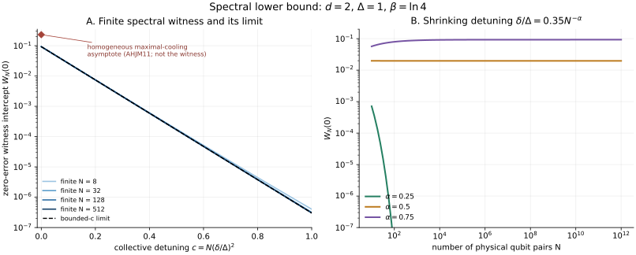
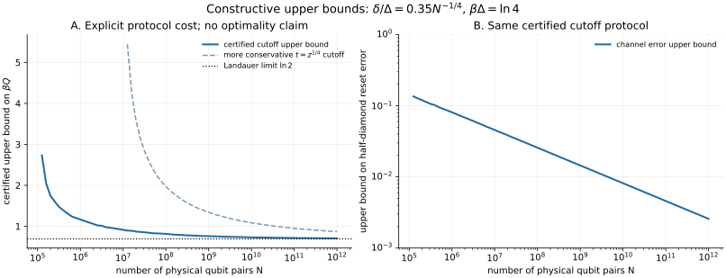

# Verification and reproduction

[Home](../README.md) · [Claim map](CLAIMS.md) · [Data contracts](../results/README.md) · [Machine-readable summary](../results/summary.json)

The universal and asymptotic assertions are established by the [analytical proofs](../science/README.md). The numerical work checks independent finite consequences, the explicit permutation, and the implementation of the bounds. It also compares the lower bound with a finite population-constrained optimum. These are different kinds of evidence, with the distinctions retained in the tables and figures.

## Reproduce the checks

Use Python 3.11 or later. The committed results were generated with Python 3.12.14 and the exact package versions in [requirements.txt](../requirements.txt): NumPy 2.3.5, SciPy 1.17.0, and Matplotlib 3.10.8.

From the repository root:

```bash
python -m venv .venv
source .venv/bin/activate
python -m pip install -r requirements.txt
python -m unittest discover -s tests -v
python scripts/run_checks.py
```

On Windows, activate the environment with `.venv\Scripts\Activate.ps1`. No test-runner package is required: the suite uses Python's `unittest`.

The last command rewrites the six reference CSV tables, `results/summary.json`, and the two scientific SVG figures. To reproduce into an ignored directory while preserving the committed files:

```bash
python scripts/run_checks.py --output-dir results/generated --figures-dir results/generated/figures
```

The seed is `20261028`; additional finite tests use their explicitly recorded fixed seeds. Dependency versions and the environment are recorded in the summary. Floating-point residuals can differ across numerical-library versions and platforms, so scientific comparisons should use the stated tolerances rather than assume universal byte identity.

## What is checked

| Check | Independent comparison | Scientific purpose |
|---|---|---|
| Exact Landauer identity | Direct relative entropy versus heat and output entropy | Detect sign, partial-trace, and entropy-convention mistakes. |
| Finite spectral product | Explicit bath-spectrum moment versus the paired product formula | Check that the product is already the squared witness modulus. |
| Coherent-unitary converse | Entropy production versus the bound for coherent perturbations of cooling permutations, Haar unitaries, and controls | Exercise positive witness corrections as well as cases where the correction vanishes. |
| Finite population optimization | A doubly stochastic linear program, an explicitly attainable coherent interior point, and exhaustive four-dimensional permutation comparisons | Check the finite optimization and its unitary-orbit interpretation. |
| Complete compression permutation | Full basis bijection, energy changes, and the induced channel on each good bath basis state | Check the overflow completion and that the good branch resets the entire input space. |
| Reference correlations | Apply the full small-bath channel to sampled entangled inputs and compare trace distance with the bath-tail bound | Check channel-tensor and reference conventions; the all-input diamond bound follows from the channel decomposition proof. |
| Binomial expansion | Exact integer cumulative counts at every shell below accepted cutoffs | Check the finite rank certificate independently of logarithmic approximations. |
| Uniform explicit selector | Exact rank condition for small gaps and large virtual baths | Check representative cases of the selector used in the joint-limit proof. |

The implementation is split by role: [spectral.py](../src/landauer_bath/spectral.py), [compression.py](../src/landauer_bath/compression.py), and [optimization.py](../src/landauer_bath/optimization.py). The tests are in [test_scientific_checks.py](../tests/test_scientific_checks.py); [run_checks.py](../scripts/run_checks.py) generates the committed tables and figures.

## Reference run

The reference numerical normalization is $`d=2`$, $`\Delta=1`$, and $`\beta=\ln4`$. It is nonresonant because $`\ln2/(\beta\Delta)=1/2`$. Some permutation and integer-count rows additionally test $`d=3`$.

| Quantity | Reference result |
|---|---:|
| Explicit unitary cases | 42 |
| Cases with a positive spectral correction | 24 |
| Largest joint dimension in the unitary table | 128 |
| Largest entropy-identity residual | $`1.78\times10^{-15}`$ |
| Finite population-constrained LP instances | 32 |
| Smallest numerical optimum minus witness heat bound | $`0.0227`$ |
| Largest doubly stochastic constraint residual | $`5.55\times10^{-16}`$ |
| Enumerated cutoff permutations | 7 |
| Exact cumulative shell inequalities checked | 6,029 |

The least witness slack over all sampled unitaries is about $`-6.7\times10^{-16}`$, consistent with floating-point roundoff at a zero-slack control. All positive-correction cases have positive slack; the smallest is approximately $`0.154`$. The summary and raw tables retain the unrounded values.

## Reading the finite optimizer correctly

The LP minimizes bath heat for the input $`I_d/d`$ subject to a target-population error. Both are diagonal observables. The [Schur–Horn theorem](../references/LITERATURE.md#schurhorn) says that the possible output diagonals are exactly the vectors majorized by the initial spectrum. Equivalently, they are the images of that spectrum under doubly stochastic matrices. This makes the mathematical optimization exact over all joint unitaries for those two observables.

The transport matrix returned by the solver need not itself be unistochastic. Schur–Horn guarantees some unitary with the same output population vector, which is sufficient for this objective. It does not turn the calculation into a diamond-norm or universal-channel optimization. The reported optimum is numerical, with solver residuals, rather than a formal exact-arithmetic certificate. Finite error–heat optimization is established prior work [MMO16](../references/LITERATURE.md#mmo16).

## Reading the figures correctly

### Spectral obstruction



The plotted quantity is $`W_N(0)=A_N\kappa^2/2`$, the zero-error intercept of the finite entropy-production lower bound. No finite full-rank bath permits an exact reset. Thus a plotted intercept is neither an attained finite-bath heat nor the optimal heat. Along vanishing-error sequences, its nonzero limit supplies the positive heat floor proved in [S1](../science/theorem.md#s1-finite-spectral-heat-bound).

The separate homogeneous marker is the known maximal-cooling asymptote from [AHJM11](../references/LITERATURE.md#ahjm11). At this normalization its excess is $`(\ln2)/3`$, larger than the witness intercept. It illustrates that the present lower bound need not be tight.

### Explicit constructive bounds



This figure takes $`\delta_N/\Delta=0.35N^{-1/4}`$. Every plotted protocol satisfies the finite integer rank-expansion criterion. The plotted heat is an upper bound for every memory input, and the plotted error bounds half the diamond distance from the pure replacement channel. These are protocol bounds, not an optimized finite frontier.

The main curve uses a less conservative cutoff than the selector chosen for the uniform proof. Its margin is $`t=\tfrac12\sqrt{\ln(1+z)}`$ in $`k=\lfloor mp_b+t\sqrt m\rfloor`$. The proof-style cutoff $`t=z^{1/4}`$ is shown separately. The finite rank condition is checked for each accepted point. A missing certificate indicates failure of that chosen cutoff/search, not a physical impossibility.

At the largest tabulated point, $`N=10^{12}`$, the main construction gives the evaluated bounds $`\beta Q\lesssim0.706456`$ and half-diamond error $`\lesssim0.002577`$, compared with $`\ln2\approx0.693147`$. This large bath size reflects a sufficient construction and conservative concentration bounds; it is not a lower bound on the resources of every possible protocol.

## Numerical limits

The large-bath calculations never enumerate their Hilbert spaces. Rank-expansion acceptance uses exact Python integer arithmetic. Gibbs occupations, binomial-tail evaluations, heat bounds, and concentration bounds use floating-point arithmetic. Positive analytic probability bounds are kept positive on underflow, with logarithmic values recorded where needed; none is presented as an exact zero error. This is not an interval-arithmetic verification of the transcendental factors.

The analytical arguments cover arbitrary bath size, all permitted unitaries, and all memory/reference inputs within the stated assumptions. Finite samples alone cover none of those universal quantifiers. The checks also do not establish efficient gate synthesis, operation time, generic-disorder sufficiency, or the exact optimal heat in the critical window.
